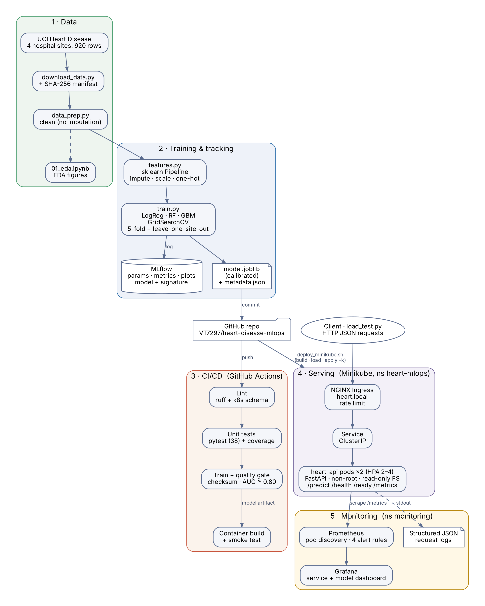

# Heart Disease Risk — End-to-End MLOps

BITS Pilani WILP · MLOps (AIMLCZG523) · Assignment 1

A heart-disease risk classifier built and operated with MLOps practice end to end: reproducible data acquisition, tracked experiments, automated CI/CD with a quality gate, a containerised FastAPI service, deployment to Kubernetes behind an Ingress, and Prometheus + Grafana monitoring.



## Results at a glance

| | Value |
|---|---|
| Data | UCI Heart Disease, **all 4 hospital sites** (Cleveland, Hungary, Switzerland, VA) — 918 patients after de-duplication |
| Selected model | Logistic Regression (L2, C = 0.3), impute-only features, sigmoid-calibrated |
| Held-out test set (184 patients) | ROC-AUC **0.889** · accuracy 0.788 · precision 0.789 · recall 0.843 · F1 0.815 |
| Leave-one-site-out ROC-AUC | **0.807** mean (Hungary 0.891 · Cleveland 0.864 · Switzerland 0.751 · VA 0.722) |
| Tests | 38 unit/API tests, run on every push |

Model selection uses **leave-one-site-out** validation (train on three hospitals, test on the fourth) rather than ordinary cross-validation. Missing-value indicators raised normal CV AUC for every model but did not improve — and for logistic regression reduced — performance on an unseen hospital, because missingness in this dataset mostly encodes *which site* a patient came from. See `report/figures/07_cv_vs_loso.png`.

## Repository layout

```
data/            download_data.py · raw/ (+ manifest.json with SHA-256) · processed/
notebooks/       01_eda.ipynb
src/             data_prep.py · features.py · train.py · inference.py · predict.py · plot_comparison.py
api/             app.py (FastAPI) · schemas.py (input validation)
tests/           38 tests: data cleaning, features, training (end-to-end), inference, API
docker/          Dockerfile (multi-stage, non-root)
k8s/             Deployment · Service · Ingress · HPA · PDB · Namespace (kustomize)
k8s/monitoring/  Prometheus (+ alert rules) · Grafana (+ provisioned dashboard) · RBAC · Ingress
scripts/         container_smoke_test.sh · deploy_minikube.sh · verify_deployment.sh
                 deploy_monitoring.sh · load_test.py · build_dashboard.py
.github/workflows/ci.yml   lint → test → train (+ quality gate) → container build & smoke test
models/          model.joblib · model_metadata.json
report/          final report · figures/ · model_comparison.csv
screenshots/     evidence for every task
```

## 1. Setup from a clean machine

Tested on macOS (Apple Silicon) with Podman and Minikube; any Linux/macOS with Docker works the same.

```bash
git clone https://github.com/VT7297/heart-disease-mlops.git
cd heart-disease-mlops
python3.11 -m venv .venv && source .venv/bin/activate
pip install -r requirements.txt
```

## 2. Data and EDA

```bash
python data/download_data.py      # downloads 4 UCI sites, writes data/raw/ + SHA-256 manifest
python src/data_prep.py           # -> data/processed/heart_disease_clean.csv
jupyter notebook notebooks/01_eda.ipynb
```

Cleaning only fixes clearly invalid values (duplicates, `chol`/`trestbps` recorded as 0, out-of-range category codes). Imputation, scaling and encoding happen inside the sklearn `Pipeline`, fitted on training folds only.

## 3. Train and track experiments

```bash
python src/train.py               # 6 tuning runs + 1 final run, ~3 min
mlflow ui --backend-store-uri mlruns   # http://127.0.0.1:5000
python src/plot_comparison.py     # report/figures/07_cv_vs_loso.png
```

Outputs: `models/model.joblib`, `models/model_metadata.json`, `report/model_comparison.csv`, and MLflow runs with parameters, metrics, ROC/calibration/confusion/feature-importance plots and the logged model with its input schema.

## 4. Tests and CI

```bash
ruff check src tests data api
pytest -q
```

GitHub Actions (`.github/workflows/ci.yml`) runs on every push:

1. **Lint** — ruff, plus strict schema validation of all Kubernetes manifests (v1.37)
2. **Unit tests** — pytest with coverage; JUnit + coverage reports uploaded
3. **Data validation & training** — raw-data checksum check, cleaning, full training, **quality gate (fails if test ROC-AUC < 0.80)**; model, metrics, plots and MLflow runs uploaded
4. **Container build & smoke test** — builds the image with the model trained in step 3, runs it, tests every endpoint

Any failure stops the pipeline at that job.

## 5. Inference

```bash
python src/predict.py samples/patient_high_risk.json          # CLI
uvicorn api.app:app                                            # API on :8000, docs at /docs
curl -X POST localhost:8000/predict -H 'Content-Type: application/json' -d @samples/patient_high_risk.json
```

`POST /predict` returns `prediction`, `label`, `confidence` (probability of the predicted class), `probability_disease`, `model_version` and `request_id`. `age`, `sex` and `cp` are required; other fields are optional and imputed. Unknown fields and out-of-range values are rejected with HTTP 422.

## 6. Container

```bash
scripts/container_smoke_test.sh heart-api:1.0     # build, run read-only, test all endpoints
```

## 7. Deploy to Kubernetes (Minikube)

```bash
minikube start --driver=vfkit && minikube addons enable ingress && minikube addons enable metrics-server
scripts/deploy_minikube.sh                        # build → load image → kubectl apply -k k8s/
scripts/verify_deployment.sh                      # tests through the Ingress, shows load balancing
echo "$(minikube ip) heart.local" | sudo tee -a /etc/hosts    # optional, for the browser: http://heart.local/docs
```

## 8. Monitoring

```bash
scripts/deploy_monitoring.sh                      # Prometheus + Grafana; prints the Grafana login
echo "$(minikube ip) grafana.local prometheus.local" | sudo tee -a /etc/hosts
python scripts/load_test.py --url http://$(minikube ip) --host heart.local --duration 480 --drift-after 300
```

- Grafana: http://grafana.local — *Heart Disease API — Service & Model Monitoring* dashboard
- Prometheus: http://prometheus.local/targets and `/alerts`
- Request logs: `kubectl -n heart-mlops logs -l app.kubernetes.io/name=heart-api --prefix`

## Security notes

Non-root containers with read-only root filesystems and all Linux capabilities dropped; `restricted` Pod Security Standard on the API namespace; Prometheus RBAC limited to listing pods in one namespace; Grafana password generated into a Kubernetes Secret at deploy time (never committed); strict input validation; Ingress body-size and rate limits; patient inputs are never written to logs.

## Report

The full write-up is in `report/` (`MLOps_Assignment1_Report.docx` / `.pdf`).
